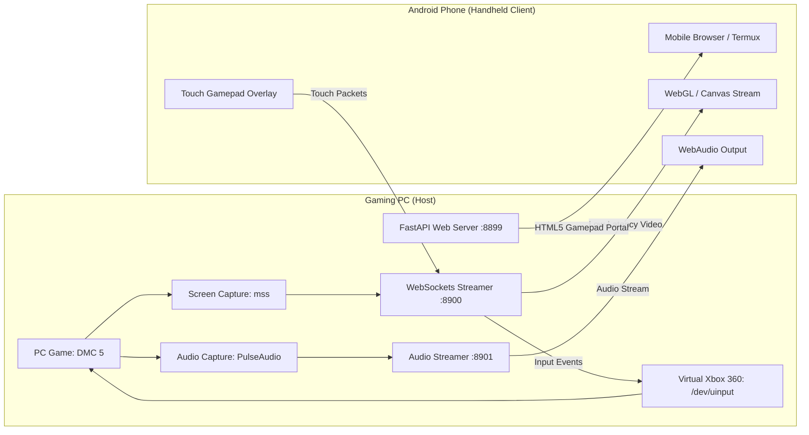

# GameGhost

> **Open-Source PC Game Casting & Mobile Handheld Portal System**  
> Turn any smartphone into a PlayStation Portal / Steam Deck style handheld console to play your PC games on the go.

```
==================================================================
   ____    _    __  __ _____ ____ _   _  ___  ____ _____ 
  / ___|  / \  |  \/  | ____/ ___| | | |/ _ \/ ___|_   _|
 | | __  / _ \ | |\/| |  _|| |  _| |_| | | | \___ \ | |  
 | |_\ \/ ___ \| |  | | |__| |_| |  _  | |_| |___) || |  
  \____/_/   \_\_|  |_|_____\____|_| |_|\___/|____/ |_|  
==================================================================
   OPEN-SOURCE PC GAME CASTING & HANDHELD TOUCH PORTAL SYSTEM
==================================================================
```

---

## What is GameGhost?

**GameGhost** transforms any Android phone (or tablet) connected via Wi-Fi or mobile hotspot into an ultra-low latency handheld gaming console. Run graphics-heavy PC games (like **Devil May Cry 5**, **Sekiro**, **Tekken 8**) on your gaming PC, and stream the video and audio directly to your phone with full on-screen touch controls.

### Key Highlights
* **Hardware Virtual Gamepad**: Emulates a native **Microsoft Xbox 360 controller** directly in the Linux kernel via `/dev/uinput`. Games detect real hardware analog thumbsticks and triggers automatically—no third-party gamepad emulators required.
* **PlayStation Portal-Style On-Screen Controls**: Dual ergonomic analog sticks (Left Stick for movement, Right Stick for camera), full D-Pad, DualSense action cluster (`▲`, `■`, `●`, `✕`), shoulder bumpers (`L1`, `R1`), and triggers (`L2`, `R2`).
* **Multi-Touch Engine**: Smooth simultaneous input. Sprint with your left thumb on the analog stick while dodging with Cross and slashing with Triangle.
* **Haptic Tactile Feedback**: Phone vibrates on every button press and trigger pull.
* **Display WakeLock**: Screen stays awake automatically while playing—no annoying auto-sleep timeouts.
* **Built-in Game Audio**: Streams real-time PC sound straight to your phone's speakers or headphones.
* **Termux & Web-Ready**: No APK installation needed! Just open your phone's browser or launch via Termux.

---

## Quick Start

### 1. Launch GameGhost Host
Start the game streaming and virtual controller host on your PC:
```bash
gameghost host
```

It will output your connection link:
```text
[PHONE PORTAL URL] : http://10.176.124.73:8899
```

### 2. Connect Your Phone
* Connect your phone to the same Wi-Fi or hotspot as your PC.
* Open Chrome, Brave, or Firefox on your phone and browse to:
  `http://<YOUR_PC_IP>:8899`
* Tap **"TAP TO ENTER FULLSCREEN"** to lock into landscape gaming mode.

### 3. Launch & Play Devil May Cry 5 Directly
Launch DMC 5 and start the streaming portal in a single command:
```bash
gameghost dmc5
```

---

## CLI Commands

| Command | Description |
| :--- | :--- |
| `gameghost host` | Start streaming host and virtual gamepad server |
| `gameghost host --fps 60 --quality 85` | Start host with custom FPS and quality settings |
| `gameghost dmc5` | Launch Devil May Cry 5 + start portal stream |
| `gameghost play <game_id>` | Launch any game from catalog (`dmc5`, `sekiro`, `tekken8`, etc.) |
| `gameghost list` | List all detected PC games |
| `gameghost gamepad` | Test `/dev/uinput` virtual Xbox controller hardware device |

---

## Android & Termux Integration

If you use Termux on your phone, you can launch the portal instantly:

```bash
# Open directly in your default Android browser from Termux
termux-open-url http://<PC_IP>:8899
```

Or run GameGhost CLI tools inside Termux directly.

---

## Controls Mapping (Xbox 360 & DMC 5)

| Touch Button | Virtual Xbox 360 | Devil May Cry 5 Action |
| :--- | :--- | :--- |
| **Left Stick** | `ABS_X` / `ABS_Y` | Player Movement (Walk / Run) |
| **Right Stick** | `ABS_RX` / `ABS_RY`| Camera Pan / Orbit |
| **▲ (Triangle)** | `BTN_Y` | Melee Sword Attack (Rebellion / Red Queen) |
| **■ (Square)** | `BTN_X` | Gun / Ranged Attack (Ebony & Ivory / Blue Rose)|
| **● (Circle)** | `BTN_B` | Style Action / Devil Breaker |
| **✕ (Cross)** | `BTN_A` | Jump / Evade |
| **L1** | `BTN_TL` | Devil Trigger |
| **R1** | `BTN_TR` | Enemy Lock-on |
| **L2 / R2** | `ABS_Z` / `ABS_RZ` | Weapon Switch / Exceed Throttle |
| **D-Pad** | `ABS_HAT0X` / `Y` | Style Switch (Trickster, Swordmaster, Royal Guard) |
| **OPTIONS** | `BTN_START` | Pause / Menu |
| **SHARE** | `BTN_SELECT` | Map / Taunt |

---

## Architecture



---

## License

Open-source under the MIT License. Built for the **rayzien** / **GameGhost** ecosystem.
