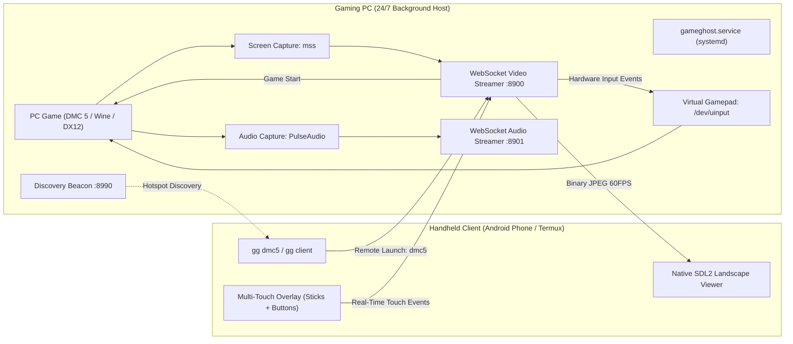

# GameGhost

```
==================================================================
   ____    _    __  __ _____ ____ _   _  ___  ____ _____ 
  / ___|  / \  |  \/  | ____/ ___| | | |/ _ \/ ___|_   _|
 | | __  / _ \ | |\/| |  _|| |  _| |_| | | | \___ \ | |  
 | |_\ \/ ___ \| |  | | |__| |_| |  _  | |_| |___) || |  
  \____/_/   \_\_|  |_|_____\____|_| |_|\___/|____/ |_|  
==================================================================
   OPEN-SOURCE PC GAME CASTING & HANDHELD TOUCH PORTAL SYSTEM
==================================================================
```

[](https://opensource.org/licenses/MIT)
[](https://github.com/rayzien/gameghost/releases)
[](https://www.python.org/)
[](https://kernel.org)
[](https://termux.dev)
[](https://www.kernel.org/doc/html/latest/input/uinput.html)
[](https://github.com/rayzien/gameghost)
[](https://github.com/rayzien/gameghost)
[](https://github.com/rayzien/gameghost)
[](https://github.com/rayzien/gameghost)
[](https://github.com/rayzien/gameghost)

---

## Overview

**GameGhost** is an open-source, ultra-low latency PC game casting and mobile handheld controller system. It turns any Android smartphone running Termux into a dedicated handheld console (similar to the PlayStation Portal or Steam Deck) to stream and control PC games over local Wi-Fi or mobile hotspot.

**Opposite of scrcpy: GameGhost mirrors your PC to your phone, not phone to PC.**

**Zero HTML. Zero Web Browsers. Zero scrcpy.**

Built on the high-efficiency architecture of **CPUGhost**, GameGhost operates as a pure native client-server system:
* **Background Host Daemon (Gaming PC)**: Runs continuously 24/7 in the background (via systemd user service `gameghost.service` or `gameghost start`). Captures game video at native refresh rates, streams over optimized binary WebSockets, and maps incoming packets directly into a hardware-level virtual Xbox 360 gamepad via Linux `/dev/uinput`.
* **Handheld Client (Phone / Termux)**: A native SDL2/Pygame-CE handheld viewer with direct framebuffer rendering, auto-discovery over hotspot Wi-Fi, and a custom multi-touch on-screen controller overlay locked into **Forced Landscape Mode**.
* **Remote Game Triggering**: Typing `gg dmc5` or any game shortcut on your phone automatically discovers the PC host on the network, triggers the game to launch on your PC, and immediately mirrors the game to your phone screen!
* **CPUGhost Auto-Update Engine**: Automatically syncs the latest releases and fixes from GitHub on both Host and Client without manual intervention.

---

## Search & Discovery Keywords (SEO)

`pc-to-phone-mirroring` `pc-game-streaming` `handheld-console` `playstation-portal-alternative` `steam-deck-alternative` `android-game-streaming` `termux-gaming` `termux-x11` `uinput-virtual-controller` `evdev-gamepad` `devil-may-cry-5-remote-play` `linux-remote-play` `touch-screen-gamepad` `low-latency-streamer` `local-hotspot-gaming` `native-sdl2-client` `auto-update-client` `forced-landscape-streaming`

---

## Key Highlights

1. **Always-Running Background Daemon**
   * Configured as a 24/7 background systemd user service (`gameghost.service`).
   * Starts on system boot and remains active in background so you never need to manually start a server when you want to play.
   * Manageable via simple commands: `gameghost start`, `gameghost stop`, `gameghost restart`, `gameghost status`.

2. **Always Launches in Landscape Mode**
   * Locks display dimensions to landscape (`width >= height`) with automatic aspect-ratio preservation.
   * Automatically sets SDL2 orientation hints (`SDL_HINT_ORIENTATIONS=LandscapeLeft LandscapeRight`).
   * In Termux-X11, locks directly into full-screen horizontal handheld layout.

3. **Remote Game Launching from Phone**
   * Running `gg dmc5` on your phone in Termux automatically finds your PC host on the network, sends a remote start command, and begins streaming the game to your phone immediately.
   * Supports all your favorite PC titles:
     * **Devil May Cry 5** (`gg dmc5`)
     * **Sekiro: Shadows Die Twice** (`gg sekiro`)
     * **Tekken 8** (`gg tekken8`)
     * **Mortal Kombat 11** (`gg mk11`)
     * **Metal Gear Rising: Revengeance** (`gg mgr`)
     * **Rise of the Tomb Raider** (`gg rottr`)

4. **Native Multi-Touch On-Screen Gamepad with L3 & R3**
   * Uses low-level SDL2 multi-touch events (`pygame.FINGERDOWN`, `pygame.FINGERMOTION`, `pygame.FINGERUP`).
   * **Dual Virtual Analog Thumbsticks**: Left Stick (LS - Movement) and Right Stick (RS - Camera).
   * **Thumbstick Click Buttons**: L3 & R3 buttons mapped right above the sticks for lock-on and sprint.
   * **Action Cluster**: Y (Triangle), X (Square), B (Circle), A (Cross).
   * **Directional Pad (D-Pad)**: Up, Down, Left, Right for instant style switching in Devil May Cry 5.
   * **Shoulders & Triggers**: L1 (LB), R1 (RB), L2 (LT analog trigger), R2 (RT analog trigger).
   * **System Buttons**: Select / Share, Start / Options, Home / Guide.

5. **Physical Gamepad & Keyboard Support on Phone**
   * Plug in or pair any physical controller: Xbox Wireless Controller, PS4/PS5 DualShock/DualSense, Razer Kishi, Backbone, or 8BitDo gamepad.
   * Native hot-plug detection via SDL2 joystick subsystem (`JOYDEVICEADDED`).
   * Full analog stick deadzone filtering and trigger sensitivity.
   * Physical USB/Bluetooth keyboard mapping fallback for PC & Termux.

6. **"Looking for Inputs from PC" Standby Radar & Auto-Reconnect**
   * Even when your Gaming PC is switched off or rebooting, the handheld client remains smooth and responsive.
   * Displays an animated standby radar actively scanning for PC signal without terminal spam or disconnection crashes.
   * Automatically discovers the PC host and begins streaming 60 FPS video the moment the PC powers on.
   * Bounded input buffers drop stale touch events during downtime, guaranteeing zero input lag upon reconnect.

7. **Hardware Virtual Xbox 360 Gamepad (Linux uinput)**
   * Emulates a native Microsoft Xbox 360 controller directly in the Linux kernel via `/dev/uinput`.
   * Recognized automatically by Steam, Proton, Wine, and native Linux games.

8. **CPUGhost-Derived Auto-Update Engine**
   * Modeled directly after CPUGhost's auto-update system.
   * Every launch silently checks GitHub (`rayzien/gameghost`) for the latest release commits and applies updates automatically.
   * Can also be run explicitly via `gameghost update`.

---

## Quick Start

### 1. On Your Gaming PC (Host)

Run setup once:
```bash
git clone https://github.com/rayzien/gameghost.git
cd gameghost
./setup.sh
```
`setup.sh` automatically configures permissions and enables the background systemd service so GameGhost is always active!

To verify status:
```bash
gameghost status
```

To start or stop the background host manually:
```bash
gameghost start    # Start host in background
gameghost stop     # Stop background host
```

---

### 2. On Your Android Phone (Termux Native Client)

#### A. Install Prerequisites in Termux
Open Termux on your phone and run:
```bash
pkg update
pkg install -y python git x11-repo
pkg install -y termux-x11-nightly python-pygame
pip install websockets rich pillow
```

#### B. Clone & Install GameGhost
```bash
git clone https://github.com/rayzien/gameghost.git
cd gameghost
./setup.sh
```

#### C. Cast and Play Any Game on Your Phone
Open **Termux-X11** on your phone, then in Termux run:
```bash
# Launch Devil May Cry 5 and cast to phone in Landscape mode:
gg dmc5

# Launch Sekiro:
gg sekiro

# Launch Tekken 8:
gg tekken8

# Or open the interactive mobile touch menu:
gg
```
GameGhost automatically finds your PC host, triggers the game on your PC, and starts streaming to your phone in landscape mode!

---

## Auto-Update System

To check for updates manually on either the PC host or the phone client:
```bash
gameghost update
```

Options:
```bash
gameghost update --check   # Check if updates are available without applying
gameghost update --force   # Force reset to latest upstream main branch
```

---

## CLI Command Reference

| Command | Arguments | Purpose |
| :--- | :--- | :--- |
| `gg` | None | Interactive mobile touch menu (for phone typing) |
| `gg dmc5` / `gameghost dmc5` | None | Launch Devil May Cry 5 on PC & cast to phone |
| `gg sekiro` / `gameghost sekiro`| None | Launch Sekiro on PC & cast to phone |
| `gg tekken8` / `gameghost tekken8`| None | Launch Tekken 8 on PC & cast to phone |
| `gg mk11` / `gameghost mk11` | None | Launch Mortal Kombat 11 on PC & cast to phone |
| `gg mgr` / `gameghost mgr` | None | Launch Metal Gear Rising on PC & cast to phone |
| `gg rottr` / `gameghost rottr` | None | Launch Rise of the Tomb Raider on PC & cast to phone |
| `gg client` / `gameghost client`| `[host_ip]` | Launch native handheld client in Landscape mode |
| `gg scan` / `gameghost scan` | None | Scan Wi-Fi / hotspot subnet for PC gaming host |
| `gg start` / `gameghost start` | None | Start streaming host daemon in background |
| `gg stop` / `gameghost stop` | None | Stop background GameGhost host process |
| `gg status` / `gameghost status`| None | Display active IP, host status, and ports |
| `gg list` / `gameghost list` | None | List available PC games ready to cast |
| `gg update` / `gameghost update`| `--force`, `--check` | Check GitHub and apply latest updates |
| `gg gamepad` / `gameghost gamepad`| None | Verify `/dev/uinput` hardware virtual gamepad |

---

## Input Mapping (Xbox 360 & Devil May Cry 5)

| Touch Control | Linux uinput Code | Devil May Cry 5 Action |
| :--- | :--- | :--- |
| **Left Stick** | `ABS_X` / `ABS_Y` | Player Movement (Walk / Sprint) |
| **Right Stick** | `ABS_RX` / `ABS_RY` | Camera Orientation / Target Orbit |
| **Y Button** | `BTN_Y` | Melee Sword Attack (Rebellion / Red Queen) |
| **X Button** | `BTN_X` | Ranged Gun Attack (Ebony & Ivory / Blue Rose) |
| **B Button** | `BTN_B` | Style Action / Devil Breaker Special |
| **A Button** | `BTN_A` | Jump / Air Hike / Evasion |
| **L1 (LB)** | `BTN_TL` | Devil Trigger Activation |
| **R1 (RB)** | `BTN_TR` | Lock-on Target Tracking |
| **L2 (LT)** | `ABS_Z` | Weapon Cycle / Change Guns |
| **R2 (RT)** | `ABS_RZ` | Exceed Throttle / Secondary Action |
| **D-Pad** | `ABS_HAT0X` / `ABS_HAT0Y` | Style Select (Trickster, Swordmaster, Royal Guard) |
| **OPTIONS** | `BTN_START` | Pause Menu / Inventory |
| **SHARE** | `BTN_SELECT` | Taunt / In-Game Map |

---

## Architecture Flow



---

## Credits & Acknowledgements

GameGhost is built and maintained by:

* **rayzien** ([@rayzien](https://github.com/rayzien))
  * Creator and lead maintainer of GameGhost.
  * Architect of the PC-to-phone casting system, native SDL2 landscape touch interface, background daemon service, and the Linux kernel `/dev/uinput` virtual Xbox 360 controller subsystem.

* **pheonix14** ([@pheonix14](https://github.com/pheonix14))
  * Creator of the **CPUGhost** project.
  * Architectural foundation for headless desktop screen capture, low-latency WebSocket frame distribution, local network hotspot discovery, and update verification patterns.

---

## License

This project is licensed under the **MIT License**. See the `LICENSE` file for details.
<!-- commit-step: 2 -->
<!-- commit-step: 3 -->
<!-- commit-step: 4 -->
<!-- commit-step: 5 -->
<!-- commit-step: 6 -->
<!-- commit-step: 7 -->
<!-- commit-step: 8 -->
<!-- commit-step: 9 -->
<!-- commit-step: 10 -->
<!-- commit-step: 11 -->
<!-- commit-step: 12 -->
<!-- commit-step: 13 -->
<!-- commit-step: 14 -->
<!-- commit-step: 15 -->
<!-- commit-step: 16 -->
<!-- commit-step: 17 -->
<!-- commit-step: 18 -->
<!-- commit-step: 19 -->
<!-- commit-step: 20 -->
<!-- commit-step: 21 -->
<!-- commit-step: 22 -->
<!-- commit-step: 23 -->
<!-- commit-step: 24 -->
<!-- commit-step: 25 -->
<!-- commit-step: 27 -->
<!-- commit-step: 28 -->
<!-- commit-step: 29 -->
<!-- commit-step: 30 -->
<!-- commit-step: 31 -->
<!-- commit-step: 32 -->
<!-- commit-step: 33 -->
<!-- commit-step: 34 -->
<!-- commit-step: 35 -->
<!-- commit-step: 36 -->
<!-- commit-step: 37 -->
<!-- commit-step: 38 -->
<!-- commit-step: 39 -->
<!-- commit-step: 40 -->
<!-- commit-step: 41 -->
<!-- commit-step: 42 -->
<!-- commit-step: 43 -->
<!-- commit-step: 44 -->
<!-- commit-step: 45 -->
<!-- commit-step: 46 -->
<!-- commit-step: 47 -->
<!-- commit-step: 48 -->
<!-- commit-step: 49 -->
<!-- commit-step: 50 -->
<!-- commit-step: 51 -->
<!-- commit-step: 52 -->
<!-- commit-step: 53 -->
<!-- commit-step: 54 -->
<!-- commit-step: 55 -->
<!-- commit-step: 56 -->
<!-- commit-step: 57 -->
<!-- commit-step: 58 -->
<!-- commit-step: 59 -->
<!-- commit-step: 60 -->
<!-- commit-step: 62 -->
<!-- commit-step: 63 -->
<!-- commit-step: 64 -->
<!-- commit-step: 65 -->
<!-- commit-step: 66 -->
<!-- commit-step: 67 -->
<!-- commit-step: 68 -->
<!-- commit-step: 69 -->
<!-- commit-step: 70 -->
<!-- commit-step: 71 -->
<!-- commit-step: 72 -->
<!-- commit-step: 73 -->
<!-- commit-step: 74 -->
<!-- commit-step: 75 -->
<!-- commit-step: 76 -->
<!-- commit-step: 77 -->
<!-- commit-step: 78 -->
<!-- commit-step: 79 -->
<!-- commit-step: 80 -->
<!-- commit-step: 81 -->
<!-- commit-step: 82 -->
<!-- commit-step: 83 -->
<!-- commit-step: 84 -->
<!-- commit-step: 85 -->
<!-- commit-step: 86 -->
<!-- commit-step: 87 -->
<!-- commit-step: 88 -->
<!-- commit-step: 89 -->
<!-- commit-step: 90 -->
<!-- commit-step: 91 -->
<!-- commit-step: 92 -->
<!-- commit-step: 93 -->
<!-- commit-step: 95 -->
<!-- commit-step: 96 -->
<!-- commit-step: 97 -->
<!-- commit-step: 98 -->
<!-- commit-step: 99 -->
<!-- commit-step: 100 -->
<!-- commit-step: 101 -->
<!-- commit-step: 102 -->
<!-- commit-step: 103 -->
<!-- commit-step: 104 -->
<!-- commit-step: 105 -->
<!-- commit-step: 106 -->
<!-- commit-step: 107 -->
<!-- commit-step: 108 -->
<!-- commit-step: 109 -->
<!-- commit-step: 110 -->
<!-- commit-step: 111 -->
<!-- commit-step: 112 -->
<!-- commit-step: 113 -->
<!-- commit-step: 114 -->
<!-- commit-step: 115 -->
<!-- commit-step: 116 -->
<!-- commit-step: 117 -->
<!-- commit-step: 118 -->
<!-- commit-step: 119 -->
<!-- commit-step: 120 -->
<!-- commit-step: 121 -->
<!-- commit-step: 122 -->
<!-- commit-step: 123 -->
<!-- commit-step: 124 -->
<!-- commit-step: 125 -->
<!-- commit-step: 126 -->
<!-- commit-step: 127 -->
<!-- commit-step: 128 -->
<!-- commit-step: 130 -->
<!-- commit-step: 131 -->
<!-- commit-step: 132 -->
<!-- commit-step: 133 -->
<!-- commit-step: 134 -->
<!-- commit-step: 135 -->
<!-- commit-step: 136 -->
<!-- commit-step: 137 -->
<!-- commit-step: 138 -->
<!-- commit-step: 139 -->
<!-- commit-step: 140 -->
<!-- commit-step: 141 -->
<!-- commit-step: 142 -->
<!-- commit-step: 143 -->
<!-- commit-step: 144 -->
<!-- commit-step: 145 -->
