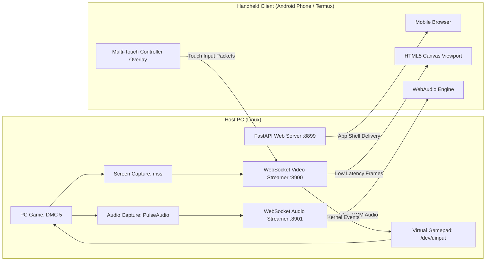

# GameGhost

```
==================================================================
   ____    _    __  __ _____ ____ _   _  ___  ____ _____ 
  / ___|  / \  |  \/  | ____/ ___| | | |/ _ \/ ___|_   _|
 | | __  / _ \ | |\/| |  _|| |  _| |_| | | | \___ \ | |  
 | |_\ \/ ___ \| |  | | |__| |_| |  _  | |_| |___) || |  
  \____/_/   \_\_|  |_|_____\____|_| |_|\___/|____/ |_|  
==================================================================
   OPEN-SOURCE PC GAME CASTING & HANDHELD TOUCH PORTAL SYSTEM
==================================================================
```

[](https://opensource.org/licenses/MIT)
[](https://www.python.org/)
[](https://kernel.org)
[](https://termux.dev)
[](https://www.kernel.org/doc/html/latest/input/uinput.html)

---

## Overview

**GameGhost** is an open-source, ultra-low latency PC game casting and mobile handheld controller system. It turns any Android smartphone, tablet, or browser client into a dedicated handheld console (similar to the PlayStation Portal or Steam Deck) to stream and control PC games over local Wi-Fi or mobile hotspot.

Running on the host PC (Linux), GameGhost captures active games (including Wine/Proton titles like **Devil May Cry 5**, **Sekiro**, **Tekken 8**) and streams hardware-accelerated video and audio directly to your mobile browser or Termux session. It exposes a native Linux kernel virtual Xbox 360 controller via `/dev/uinput`, translating phone touch gestures into hardware gamepad inputs.

---

## Search & Discovery Keywords (SEO)

`pc-game-streaming` `handheld-console` `playstation-portal-alternative` `steam-deck-alternative` `android-game-streaming` `termux-gaming` `uinput-virtual-controller` `evdev-gamepad` `devil-may-cry-5-remote-play` `linux-remote-play` `touch-screen-gamepad` `low-latency-streamer` `local-hotspot-gaming`

---

## Key Features

1. **Native Hardware Virtual Controller (Xbox 360 via uinput)**
   * Uses Linux `/dev/uinput` through `evdev` to create an authentic virtual Microsoft Xbox 360 gamepad.
   * Recognized automatically by games running under Steam, Proton, Wine, or native Linux without requiring external controller emulators.
   * Provides true 16-bit analog stick resolution (-32768 to 32767) and 8-bit analog trigger axes (0 to 255).

2. **PlayStation Portal-Style Touch Interface**
   * **Dual Analog Thumbsticks**: Left Stick (LS) for character movement, Right Stick (RS) for camera control.
   * **Action Cluster**: Y (Triangle), X (Square), B (Circle), A (Cross).
   * **Directional Pad (D-Pad)**: Up, Down, Left, Right for instant weapon or style switching.
   * **Shoulders & Triggers**: L1 (LB), R1 (RB), L2 (LT analog trigger), R2 (RT analog trigger).
   * **System Controls**: Select / Share, Start / Options, Home / Guide.

3. **Multi-Touch Engine**
   * Independent pointer tracking prevents input cancellation.
   * Run with the left thumbstick while holding lock-on (R1) and executing attack combinations simultaneously.

4. **Haptic Vibration Feedback**
   * Employs the HTML5 Vibration API (`navigator.vibrate`) to deliver tactile feedback upon button strikes.

5. **Display WakeLock & Immersive Fullscreen**
   * Utilizes the Screen WakeLock API to keep the mobile display awake indefinitely during gameplay.
   * One-tap fullscreen prompt locks browser orientation into landscape.

6. **Zero APK Installation Required**
   * Fully compatible with standard mobile browsers (Chrome, Brave, Firefox) and Android Termux via `termux-open-url`.

---

## Quick Start

### 1. Host Installation
Clone the repository and run the setup script:
```bash
git clone https://github.com/rayzien/gameghost.git
cd gameghost
./setup.sh
```

### 2. Start the GameGhost Host
Launch the streaming server and virtual gamepad host:
```bash
gameghost host
```

Terminal output will display your local network access link:
```text
==================================================================
       [GAMEGHOST HANDHELD STREAMING HOST ONLINE]
==================================================================
 [HOST IP]              : 10.176.124.73
 [PHONE PORTAL URL]     : http://10.176.124.73:8899
 [STREAM WEBSOCKET]     : ws://10.176.124.73:8900
 [AUDIO WEBSOCKET]      : ws://10.176.124.73:8901
 [VIRTUAL CONTROLLER]   : Active (Hardware Xbox 360 Pad via uinput)
==================================================================

[CONNECT] Open this on your Phone's browser (or Termux):
   http://10.176.124.73:8899
```

### 3. Connect from Mobile Phone or Termux
Ensure your smartphone is on the same local Wi-Fi or mobile hotspot as your PC:
* **Browser**: Navigate to `http://<YOUR_PC_IP>:8899`
* **Termux**:
  ```bash
  termux-open-url http://<YOUR_PC_IP>:8899
  ```
* Tap **"TAP TO ENTER FULLSCREEN"** to engage fullscreen landscape controls.

---

## Direct Game Launching

### Launch Devil May Cry 5
Launch Devil May Cry 5 and initiate the GameGhost streaming server in a single command:
```bash
gameghost dmc5
```

### Launch from Catalog
```bash
# View detected games
gameghost list

# Launch Sekiro
gameghost play sekiro

# Launch Tekken 8
gameghost play tekken8
```

---

## CLI Command Reference

| Command | Arguments | Purpose |
| :--- | :--- | :--- |
| `gameghost host` | `--fps <int>`, `--quality <int>`, `--scale <float>` | Start streaming server and virtual controller |
| `gameghost dmc5` | `--fps <int>`, `--quality <int>` | Launch Devil May Cry 5 + stream to phone |
| `gameghost play <id>` | `<game_id>` | Launch selected game + stream to phone |
| `gameghost list` | None | List detected PC games and installation paths |
| `gameghost gamepad` | None | Verify `/dev/uinput` hardware virtual gamepad |

---

## Input Mapping (Xbox 360 & Devil May Cry 5)

| Touch Control | Linux uinput Code | Devil May Cry 5 In-Game Function |
| :--- | :--- | :--- |
| **Left Stick** | `ABS_X` / `ABS_Y` | Player Movement (Walk / Sprint) |
| **Right Stick** | `ABS_RX` / `ABS_RY` | Camera Orientation / Target Orbit |
| **Y Button** | `BTN_Y` | Melee Sword Attack (Rebellion / Red Queen) |
| **X Button** | `BTN_X` | Ranged Gun Attack (Ebony & Ivory / Blue Rose) |
| **B Button** | `BTN_B` | Style Action / Devil Breaker Special |
| **A Button** | `BTN_A` | Jump / Air Hike / Evasion |
| **L1 (LB)** | `BTN_TL` | Devil Trigger Activation |
| **R1 (RB)** | `BTN_TR` | Lock-on Target Tracking |
| **L2 (LT)** | `ABS_Z` | Weapon Cycle / Change Guns |
| **R2 (RT)** | `ABS_RZ` | Exceed Throttle / Secondary Action |
| **D-Pad** | `ABS_HAT0X` / `ABS_HAT0Y` | Style Select (Trickster, Swordmaster, Royal Guard) |
| **OPTIONS** | `BTN_START` | Pause Menu / Inventory |
| **SHARE** | `BTN_SELECT` | Taunt / In-Game Map |

---

## Architecture Flow



---

## Credits & Acknowledgements

GameGhost is built and maintained by:

* **rayzien** ([@rayzien](https://github.com/rayzien))
  * Creator and lead maintainer of GameGhost.
  * Architect of the mobile handheld portal concept, multi-touch controller interface, and the Linux kernel `/dev/uinput` virtual Xbox 360 controller subsystem.

* **pheonix14** ([@pheonix14](https://github.com/pheonix14))
  * Creator of the **CPUGhost** project.
  * Architectural foundation for headless desktop screen capture, low-latency WebSocket frame distribution, and local network hotspot discovery.

---

## License

This project is licensed under the **MIT License**. See the `LICENSE` file for details.
