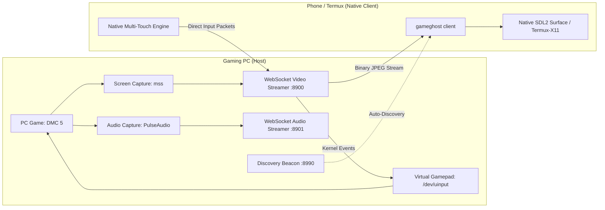

# GameGhost

```
==================================================================
   ____    _    __  __ _____ ____ _   _  ___  ____ _____ 
  / ___|  / \  |  \/  | ____/ ___| | | |/ _ \/ ___|_   _|
 | | __  / _ \ | |\/| |  _|| |  _| |_| | | | \___ \ | |  
 | |_\ \/ ___ \| |  | | |__| |_| |  _  | |_| |___) || |  
  \____/_/   \_\_|  |_|_____\____|_| |_|\___/|____/ |_|  
==================================================================
   OPEN-SOURCE PC GAME CASTING & HANDHELD TOUCH PORTAL SYSTEM
==================================================================
```

[](https://opensource.org/licenses/MIT)
[](https://www.python.org/)
[](https://kernel.org)
[](https://termux.dev)
[](https://www.kernel.org/doc/html/latest/input/uinput.html)

---

## Overview

**GameGhost** is an open-source, ultra-low latency PC game casting and mobile handheld controller system. It turns any Android smartphone running Termux into a dedicated handheld console (similar to the PlayStation Portal or Steam Deck) to stream and control PC games over local Wi-Fi or mobile hotspot.

**No HTML. No Web Browsers. No scrcpy.**

Built on the high-efficiency architecture of **CPUGhost**, GameGhost operates as a pure native client-server system:
* **Host (Gaming PC)**: Captures game video at native refresh rates, streams over optimized binary WebSockets, and maps incoming packets directly into a hardware-level virtual Xbox 360 gamepad via Linux `/dev/uinput`.
* **Client (Phone / Termux)**: A native SDL2/Pygame-CE handheld viewer with direct framebuffer rendering and a custom multi-touch on-screen controller overlay.

---

## Search & Discovery Keywords (SEO)

`pc-game-streaming` `handheld-console` `playstation-portal-alternative` `steam-deck-alternative` `android-game-streaming` `termux-gaming` `termux-x11` `uinput-virtual-controller` `evdev-gamepad` `devil-may-cry-5-remote-play` `linux-remote-play` `touch-screen-gamepad` `low-latency-streamer` `local-hotspot-gaming` `native-sdl2-client`

---

## Key Highlights

1. **Native Client Engine (No Web Browser Overhead)**
   * Built on SDL2 / Pygame-CE running directly in Termux (via Termux-X11) or native Linux.
   * Direct hardware-accelerated surface rendering with zero DOM, zero browser address bars, and zero gesture interference.

2. **Native Multi-Touch On-Screen Gamepad**
   * Uses low-level SDL2 multi-touch events (`pygame.FINGERDOWN`, `pygame.FINGERMOTION`, `pygame.FINGERUP`).
   * **Dual Virtual Analog Thumbsticks**: Left Stick (LS - Movement) and Right Stick (RS - Camera).
   * **Action Cluster**: Y (Triangle), X (Square), B (Circle), A (Cross).
   * **Directional Pad (D-Pad)**: Up, Down, Left, Right for instant style switching in Devil May Cry 5.
   * **Shoulders & Triggers**: L1 (LB), R1 (RB), L2 (LT analog trigger), R2 (RT analog trigger).
   * **System Buttons**: Select / Share, Start / Options, Home / Guide.

3. **Hardware Virtual Xbox 360 Gamepad (Linux uinput)**
   * Emulates a native Microsoft Xbox 360 controller directly in the Linux kernel via `/dev/uinput`.
   * Recognized automatically by Steam, Proton, Wine, and native Linux games.

4. **Zero-Configuration Hotspot Auto-Discovery**
   * Employs UDP discovery beacons and concurrent subnet scanning.
   * Just run `gameghost client` on your phone; it automatically locates your PC host on the mobile hotspot in under two seconds.

---

## Quick Start

### 1. On Your Gaming PC (Host)
Launch the GameGhost host:
```bash
gameghost host
```

Or launch Devil May Cry 5 directly with streaming enabled:
```bash
gameghost dmc5
```

Terminal output:
```text
==================================================================
       [GAMEGHOST HANDHELD STREAMING HOST ONLINE]
==================================================================
 [HOST IP]              : 10.176.124.73
 [STREAM WEBSOCKET]     : ws://10.176.124.73:8900
 [AUDIO WEBSOCKET]      : ws://10.176.124.73:8901
 [VIRTUAL CONTROLLER]   : Active (Hardware Xbox 360 Pad via uinput)
==================================================================
```

---

### 2. On Your Android Phone (Browser or Native Client)

#### Option A. Instant Mobile Browser Portal (Zero Apps or Setup Required!)
Open the GameGhost portal directly in Chrome, Brave, or Firefox on your phone:
```bash
# Auto-detects PC host and opens portal in phone browser:
gameghost open

# Or using the ultra-short mobile alias:
gg open
```
Tap **"TAP TO ENTER FULLSCREEN"** to lock into landscape PlayStation Portal mode.

#### Option B. Native Termux SDL2 Client (Optional via Termux-X11)
```bash
pkg install -y termux-x11-nightly python-pygame
gameghost client
```

---

## Direct Game Launching

```bash
# Launch Devil May Cry 5
gameghost dmc5

# Launch Sekiro: Shadows Die Twice
gameghost play sekiro

# Launch Tekken 8
gameghost play tekken8

# List all detected games
gameghost list
```

---

## CLI Command Reference

| Command | Arguments | Purpose |
| :--- | :--- | :--- |
| `gg` | None | Interactive mobile touch menu (for phone typing) |
| `gameghost open` / `gg open` | `[host_ip]` | Open handheld portal directly in mobile browser |
| `gameghost client` | `[host_ip]`, `--fullscreen` | Launch native SDL2 handheld client on phone |
| `gameghost scan` / `gg scan` | None | Scan Wi-Fi / hotspot subnet for PC gaming host |
| `gameghost host` | `--fps <int>`, `--quality <int>`, `--scale <float>` | Start streaming host, virtual controller & web portal |
| `gameghost stop` / `gg stop` | None | Stop background GameGhost host process |
| `gameghost status` / `gg status`| None | Display active IP, host status, and ports |
| `gameghost dmc5` | `--fps <int>`, `--quality <int>` | Launch Devil May Cry 5 + stream to phone |
| `gameghost play <id>` | `<game_id>` | Launch selected game (local or remote) + stream |
| `gameghost list` | None | List detected PC games and installation paths |
| `gameghost gamepad` | None | Verify `/dev/uinput` hardware virtual gamepad |

---

## Input Mapping (Xbox 360 & Devil May Cry 5)

| Touch Control | Linux uinput Code | Devil May Cry 5 Action |
| :--- | :--- | :--- |
| **Left Stick** | `ABS_X` / `ABS_Y` | Player Movement (Walk / Sprint) |
| **Right Stick** | `ABS_RX` / `ABS_RY` | Camera Orientation / Target Orbit |
| **Y Button** | `BTN_Y` | Melee Sword Attack (Rebellion / Red Queen) |
| **X Button** | `BTN_X` | Ranged Gun Attack (Ebony & Ivory / Blue Rose) |
| **B Button** | `BTN_B` | Style Action / Devil Breaker Special |
| **A Button** | `BTN_A` | Jump / Air Hike / Evasion |
| **L1 (LB)** | `BTN_TL` | Devil Trigger Activation |
| **R1 (RB)** | `BTN_TR` | Lock-on Target Tracking |
| **L2 (LT)** | `ABS_Z` | Weapon Cycle / Change Guns |
| **R2 (RT)** | `ABS_RZ` | Exceed Throttle / Secondary Action |
| **D-Pad** | `ABS_HAT0X` / `ABS_HAT0Y` | Style Select (Trickster, Swordmaster, Royal Guard) |
| **OPTIONS** | `BTN_START` | Pause Menu / Inventory |
| **SHARE** | `BTN_SELECT` | Taunt / In-Game Map |

---

## Architecture Flow



---

## Credits & Acknowledgements

GameGhost is built and maintained by:

* **rayzien** ([@rayzien](https://github.com/rayzien))
  * Creator and lead maintainer of GameGhost.
  * Architect of the mobile handheld portal concept, native SDL2 multi-touch controller interface, and the Linux kernel `/dev/uinput` virtual Xbox 360 controller subsystem.

* **pheonix14** ([@pheonix14](https://github.com/pheonix14))
  * Creator of the **CPUGhost** project.
  * Architectural foundation for headless desktop screen capture, low-latency WebSocket frame distribution, and local network hotspot discovery.

---

## License

This project is licensed under the **MIT License**. See the `LICENSE` file for details.
